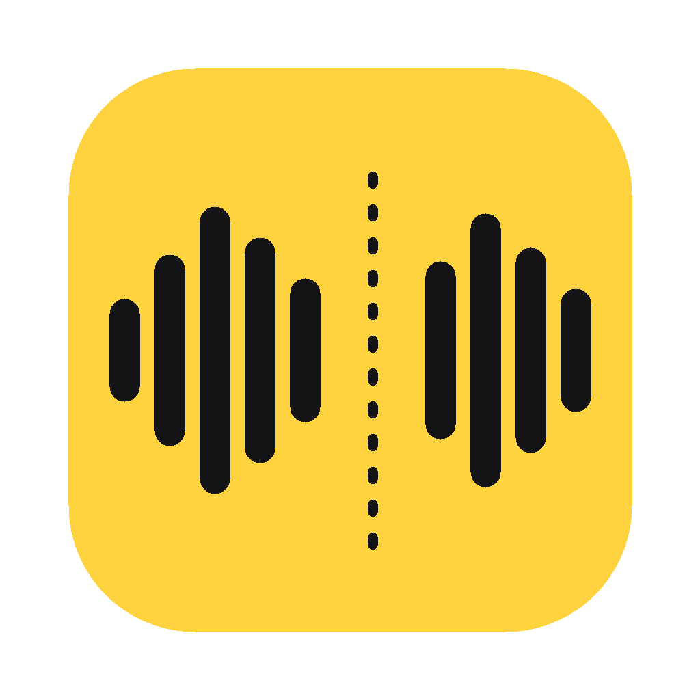

# JUMPCUT

말하는 영상에서 지루한 틈을 AI가 찾아 잘라 주는 맥 앱입니다. 토크·브이로그·강의 영상의 1차 컷 편집을 몇 분 만에 끝낼 수 있습니다.

<p align="center"></p>

AI가 찾는 것은 다섯 가지입니다.

| 종류 | 예 |
|---|---|
| 무음 | 말과 말 사이 0.5초 넘게 비는 곳 |
| 군말 | “음…”, “어…”, 앞뒤로 쉬는 “그”, “저기” |
| 반복 | “제가 요즘 쓰는, 제가 요즘 쓰는 카메라를”처럼 다시 말한 앞쪽 |
| 잡음 | 기침, 재채기, 헛기침, 코 훌쩍임 |
| 직접 | 내가 타임라인이나 자막에서 고른 구간 |

찾은 곳은 바로 자르지 않고 먼저 보여 줍니다. 하나씩 들어 보고 살리거나 자를 수 있고, 내가 원하는 구간을 더 자를 수도 있습니다.

**모든 처리는 내 맥 안에서 이뤄집니다.** 영상을 어디에도 올리지 않고, 계정이나 유료 API도 필요 없습니다.

## 설치

1. [Releases](../../releases)에서 내 맥에 맞는 dmg를 받습니다.
   - Apple Silicon(M1 이후): `JUMPCUT-x.y.z-arm64.dmg`
   - Intel 맥: `JUMPCUT-x.y.z-x86_64.dmg`
2. dmg를 열고 JUMPCUT을 응용 프로그램 폴더로 끌어다 놓습니다.
3. 처음 열 때 “확인되지 않은 개발자” 경고가 뜨면, JUMPCUT을 **우클릭 → 열기**를 누릅니다. 애플 개발자 서명을 하지 않은 앱이라 한 번만 거치는 단계입니다.

macOS 14(Sonoma) 이상이 필요합니다. 처음 분석할 때 음성 인식 모델(약 1.6GB)을 한 번 내려받습니다.

## 사용법

1. 영상을 창에 끌어다 놓거나 **영상 고르기**를 누릅니다. 말하는 언어를 고르면 정확도가 올라갑니다.
2. 분석이 끝나면 편집 화면이 열립니다.
   - **왼쪽 AI가 찾은 곳**: 줄어드는 시간, 종류별 켜기·끄기, 컷 목록. 컷마다 앞뒤 말이 함께 보이고 **▶ 듣기**로 잘린 결과를 미리 들을 수 있습니다.
   - **가운데**: 영상. **잘린 상태로 재생**을 켜면 자를 곳을 건너뛰며 재생합니다.
   - **오른쪽 자막**: 잘릴 말은 취소선, 무음과 잡음은 알약 모양으로 보입니다. 알약을 누르면 살리거나 자릅니다. 말을 드래그해서 고르면 그 부분만 자르거나 살릴 수 있습니다.
   - **아래 타임라인**: 영상 썸네일과 파형. 드래그하면 그 구간을 자르고, 컷 양끝을 끌면 길이가 바뀝니다.
3. **내보내기**를 누르면 `~/Movies/JUMPCUT/원본이름_cut.mp4`로 저장됩니다.

편집한 내용은 원본 옆 `원본이름.jumpcut.json`에 자동 저장됩니다. 같은 영상을 다시 열면 이어서 고칠 수 있습니다.

### 단축키

| 키 | 동작 |
|---|---|
| 스페이스 | 재생 / 일시정지 |
| `[` `]` | 이전 / 다음 컷 |
| `X` | 선택한 컷 켜기·끄기 |
| `⌫` | 선택한 컷 지우기 |
| `I` `O` | 재생 위치에 시작점·끝점을 찍어 자르기 |
| `P` | 잘린 상태로 재생 켜기·끄기 |
| `←` `→` | 1초 이동(Shift: 5초) |
| `⌘Z` `⇧⌘Z` | 되돌리기 / 다시 하기 |

### 찾는 기준 조정

왼쪽 **찾는 기준 조정**에서 바꿀 수 있습니다. 바꾸면 AI 컷만 다시 계산하고, 직접 자른 곳은 그대로 남습니다.

- 무음 길이 기준: 이보다 긴 무음만 자릅니다(기본 0.5초).
- 무음 감도: 높이면 작은 숨소리·잡음도 무음으로 봅니다.
- 남길 여유: 자른 자리 양옆에 남기는 숨(기본 0.15초). 작을수록 템포가 빨라집니다.
- 잡음 감도: 낮출수록 기침·훌쩍임을 더 많이 잡습니다.

## 명령줄로 쓰기

검토 없이 바로 잘린 영상을 만들 때 씁니다.

```bash
pip install git+https://github.com/kyunu20-cyber/jumpcut
jumpcut 영상.mp4                    # → ~/Movies/JUMPCUT/영상_cut.mp4
jumpcut 영상.mp4 --dry-run          # 자를 곳 목록만 출력
jumpcut 영상.mp4 --min-silence 0.8 --no-fillers -o 결과.mp4
jumpcut-app                         # 검토 화면이 있는 앱 창 열기
```

## 어떻게 동작하나

1. **받아쓰기**: Whisper large-v3-turbo로 단어마다 시각을 붙여 받아씁니다. Apple Silicon에서는 MLX(GPU), Intel에서는 faster-whisper(CPU)를 씁니다. Whisper는 보통 “음·어”를 지우고 받아쓰기 때문에, 군말을 남기도록 유도하는 프롬프트를 함께 넣습니다.
2. **무음**: 영상마다 바닥 소음과 말소리 크기를 재서 그 사이에 기준선을 긋습니다. 마이크나 방이 달라도 같은 설정으로 맞습니다.
3. **반복**: 단어 1~6개 묶음이 바로 뒤에서 거의 똑같이(85% 이상) 다시 나오면 앞쪽을 자릅니다.
4. **잡음**: YAMNet(구글의 소리 분류 모델)이 0.48초마다 소리 521종을 판정합니다. 기침 계열 점수가 높고 말 점수가 낮은 곳에서, 실제로 소리가 난 부분만 자릅니다.
5. **내보내기**: 원본을 한 번만 읽으면서 남길 프레임만 골라 이어 붙입니다. 프레임 간격이 일정하지 않은 아이폰 영상도 소리와 화면이 어긋나지 않습니다. 이음새마다 10ms 페이드를 넣어 ‘틱’ 소리를 막습니다.

## 개발

```bash
git clone https://github.com/kyunu20-cyber/jumpcut && cd jumpcut
python3.11 -m venv .venv && .venv/bin/pip install -e ".[build]" pytest
.venv/bin/python -m pytest              # 테스트
.venv/bin/jumpcut-app                   # 앱 창으로 실행
.venv/bin/uvicorn jumpcut.api:app --port 8096   # 브라우저로 개발: http://127.0.0.1:8096
PYTHON=.venv/bin/python packaging/build.sh      # dist/에 .app과 .dmg 생성
```

| 파일 | 하는 일 |
|---|---|
| `jumpcut/transcribe.py` | 모델 내려받기, 단어 단위 받아쓰기 |
| `jumpcut/detect.py` | 무음·군말·반복·잡음 찾기, 컷 합치기 |
| `jumpcut/render.py` | ffmpeg으로 잘린 영상 만들기 |
| `jumpcut/project.py` | 분석 결과와 편집 상태 저장(`.jumpcut.json`) |
| `jumpcut/api.py` | 검토 화면용 로컬 서버(127.0.0.1에만 열림) |
| `jumpcut/app.py` | 맥 앱 창 |
| `jumpcut/web/` | 검토 화면(빌드 과정 없는 HTML·JS) |
| `packaging/` | 아이콘, PyInstaller 설정, dmg 빌드 스크립트 |

`v`로 시작하는 태그를 올리면 GitHub Actions가 Apple Silicon·Intel용 dmg를 만들어 Releases에 붙입니다(`.github/workflows/release.yml`). 배포용 Apple Silicon 빌드는 반드시 macOS 14 머신에서 해야 합니다. 더 새로운 macOS에서 빌드하면 그 버전 전용 MLX가 들어가서 낮은 버전 맥에서 열리지 않습니다.

## 라이선스

MIT. 앱에 함께 들어가는 FFmpeg(GPL) 등 제3자 구성 요소는 [THIRD_PARTY_NOTICES.md](THIRD_PARTY_NOTICES.md)에 정리했습니다.

---

## English

JUMPCUT is a macOS app that finds dead air, filler words (“um”, “uh”), retakes, and coughs in talking-head videos, lets you review each cut, and exports the trimmed video. Everything runs locally: Whisper (MLX on Apple Silicon, faster-whisper on Intel) for word timestamps, YAMNet for cough/sneeze detection, and FFmpeg for a single-pass, VFR-safe render.

Download the dmg for your Mac from Releases, drag JUMPCUT to Applications, and right-click → Open on first launch (the app is not notarized). Requires macOS 14+. Set the spoken language on the start screen; Korean, English and Japanese are listed, and auto-detect works for others. CLI: `jumpcut video.mp4`. MIT licensed; see THIRD_PARTY_NOTICES.md for bundled components.
